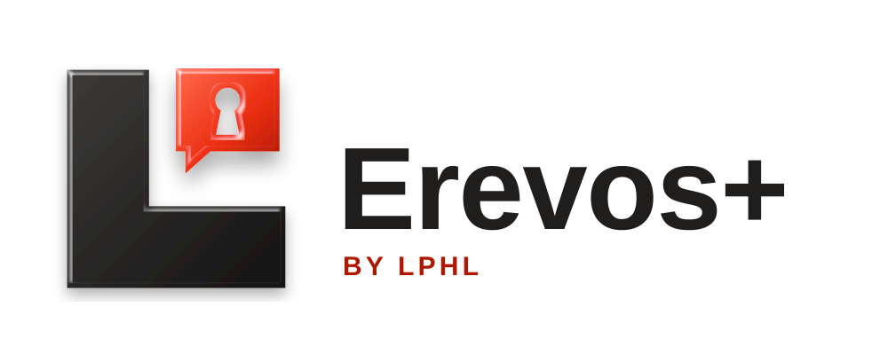

<!--
SPDX-FileCopyrightText: 2026 azzinder
SPDX-License-Identifier: AGPL-3.0-or-later
Additional terms under AGPL-3.0 section 7 apply: see AUTHORS.md.
-->

<p align="center">
  <picture>
    <source media="(prefers-color-scheme: dark)" srcset="brand/erevos-lockup-dark.svg">
    
  </picture>
</p>

<h3 align="center">Erevos, with your other chats in it.</h3>

<p align="center">
  Everything Erevos does, and next to its own chats your Telegram, Messenger, Signal, Session, Matrix and XMPP chats<br>
  and chats with other Nostr apps, in one list, behind one lock.
</p>

<p align="center">
  <a href="https://github.com/azzinder/erevos-releases/releases?q=Erevos%2B&expanded=true"><b>Download</b></a> ·
  <a href="https://lphl.nekten.eu/erevos">Website</a> ·
  <a href="https://erevosplus-web.lphl.nekten.eu">Web app</a> ·
  <a href="CHANGELOG.md">Changelog</a> ·
  <a href="docs/editions.md">Erevos+ and Erevos</a> ·
  <a href="docs/overview.md">Full overview</a>
</p>

<table align="center">
  <tr>
    <td></td>
    <td></td>
    <td></td>
  </tr>
  <tr align="center">
    <td>Add by QR</td><td>Polls</td><td>Phone</td>
  </tr>
  <tr>
    <td></td>
    <td></td>
    <td></td>
  </tr>
  <tr align="center">
    <td>Contacts</td><td>Panic button</td><td>Public groups</td>
  </tr>
</table>
<p align="center"><sub>Screens of the app in English. The QR code is an example and leads to this page.</sub></p>

> [!WARNING]
> **Early work, not audited.** No one outside the project has reviewed the code or the cryptography yet. Use it,
> test it and tell us what breaks, but do not rely on it to protect anyone's safety.

## What Erevos+ is

Erevos+ is [Erevos](https://github.com/azzinder/Erevos) with more networks in it. It is built from the
same code with more modules and the same release key, as an app of its own (`app.erevos.plus`, from 3.1.0), so the two
can sit side by side on one phone. Moving from one to the other takes everything along: the one left makes a backup for
the move, the other brings it in at its first start ([Moving between them](docs/editions.md#moving-between-them)).

| | |
|---|---|
| **Erevos, all of it** | Chats and calls with no phone number, email or account, nearby with no internet, hidden spaces, a panic button, your own server, the encrypted Collection, and the phone, SMS and contacts apps. |
| **Telegram** | Your own account, through TDLib, Telegram's own library. |
| **Messenger** | Your Facebook Messenger chats. |
| **Signal** | Your Signal account, linked to your phone's Signal or registered in Erevos+, with calls. |
| **Session** | Your Session account. |
| **Matrix** | Any homeserver, with encrypted rooms and calls. |
| **XMPP** | Any server, with OMEMO. |
| **Nostr** | Chats with people who use other Nostr apps. |
| **One place** | All of them in one chat list, behind Erevos's lock, in its first space. |

Each network is a module you turn on or off in **Settings → Modules**. What you sign in to stays on the phone.

## Who it is for

For people who already have chats on several networks and want them in one private app, without giving up the
networks their friends use. Your Erevos contacts get Erevos's own protection; your other chats keep what their own
network gives them.

If you want only Erevos's own chats, the plain [Erevos](https://github.com/azzinder/Erevos) is smaller and does
less, on more platforms.

## Get it

| Where | How |
|---|---|
| **Android 8 or later, 64-bit** | `erevos-plus-android.apk` from the [Erevos+ releases](https://github.com/azzinder/erevos-releases/releases?q=Erevos%2B&expanded=true). |
| **From Erevos** | In the app: **Settings → General → Updates → Next update: Erevos+ → Check for updates**. Erevos+ installs beside Erevos and, once opened, brings your chats along. Going back works the same way, with **Next update: Erevos**. |
| **Any browser** | The [Erevos+ web app](https://erevosplus-web.lphl.nekten.eu): Erevos, Matrix with calls, XMPP, Nostr and the Collection. Telegram, Messenger, Signal, Session, the phone and SMS need Android. |

Erevos+ is for Android only. For iPhone, Linux, Windows, macOS and Sailfish OS there is the plain Erevos.

> [!NOTE]
> Erevos+ releases are titled **Erevos+ x.y.z** and are never marked *Latest* on GitHub, so a `releases/latest` link
> always gives the plain Erevos.

### Only from these places

Get Erevos+ only from the [releases page](https://github.com/azzinder/erevos-releases/releases?q=Erevos%2B&expanded=true),
the [web app](https://erevosplus-web.lphl.nekten.eu), the [website](https://lphl.nekten.eu/erevos) or the app's own
**Updates**. A copy from anywhere else is not ours.

Every Android release, Erevos's and Erevos+'s, is signed with the same key. The SHA-256 of its certificate
(`CN=Erevos, O=LPHL, C=GR`):

```
49:F0:D9:BE:60:09:2F:02:CF:27:C5:24:67:52:55:01:93:A6:7B:81:21:29:BF:53:41:79:53:B7:C8:79:8E:69
```

Compare it with `apksigner verify --print-certs erevos-plus-android.apk`. Each release also lists the SHA-256 of
its files.

## Honest limits

- **Not audited.** The cryptography follows published designs, but no independent expert has checked the code.
  An [AI-assisted review](#ai-assisted-security-review-november-2026) is not a substitute for one.
- **The other networks see what they always see.** A Telegram, Messenger, Signal, Session, Matrix or XMPP chat is
  as private in Erevos+ as that network makes it, no more. Erevos+ is not made or approved by any of them.
- **Not everything has been tried on real phones.** The newest features among them; the changelog and the guide say
  which.
- **A server sees some things.** Not what you write, but when messages arrive and, unless you turn Tor on, the address
  your phone connects from.
- **SMS are not private.** When Erevos+ is your SMS app, your carrier sees SMS as with any app.

In plain words, for Erevos's own chats: [the servers Erevos talks to](docs/servers.md), what each sees and keeps
([Ελληνικά](docs/servers.el.md)), and [what a stolen phone or key opens](docs/stolen-key.md)
([Ελληνικά](docs/stolen-key.el.md)).

Read more: [threat model](docs/threat-model.md) · [security review map](docs/security-review.md) ·
[protocol](docs/protocol.md) · [reporting a problem](SECURITY.md) · the guide's *Transparency* part.

## Other networks

Erevos+ is an independent project. It is not affiliated with, endorsed by or connected to Meta, Telegram, Signal,
Session or any other network it can reach. Their names are used only to say which networks it works with, and they
belong to their owners.

Each network is reached with your own account and on your own choice. Telegram goes through TDLib, Telegram's own
library, with this project's own API id; a build of your own needs an API id of its own. Messenger and Signal are
reached the way their own web and desktop apps are, with code from mautrix-meta and presage. A network may not allow
other apps, and may limit or close an account it finds using one: use them knowing that. Your Erevos contacts are not
affected by any of this.

## AI-assisted security review (November 2026)

In November 2026 the code was reviewed for security with the help of an AI model (ChatGPT), using
these workflows: VIDOC Security Review (code review and validation of suspected findings),
Security Advisory Scout (dependency advisories from OSV and NVD, with FIRST EPSS and CISA KEV), and
Authorized Security Review. It was a static review, with some tests run. **It is not an audit or a
certification:** no person outside the project checked the code. The workflows ran only on the
source we supplied; the VIDOC one does not connect to Vidoc's platform or scanning service.

Every finding was checked against the code before anything changed. Of the 18 that held as problems
(three more were choices made on purpose), 13 are fixed and one more is reduced, in Erevos
3.0.0-beta.2 and 3.0.0-rc.1, with tests for the code changes. The rest, and what the review did
not cover, are listed in [docs/ai-review-2026-11.md](docs/ai-review-2026-11.md).

## Build it

Erevos+ is the default edition (`EREVOS_EDITION=plus`; `erevos` gives the plain Erevos, `lite` Erevos Lite). The Rust crates:

```
cargo test
```

The app's checks, from `app/`, with Node 22, Rust with the `wasm32-unknown-unknown` target and wasm-bindgen-cli
0.2.129:

```
npm ci
npm run typecheck
node checks/build-core.mjs
cargo build -p erevos-relay
npm run check
```

The Android app is built by `.github/workflows/erevosgram.yml`: `npx expo prebuild --platform android`, then Gradle.
Telegram is in it only with `EREVOS_TELEGRAM=1`, and needs TDLib built by `scripts/build-tdlib.sh`
([docs/erevosgram.md](docs/erevosgram.md)). More in [docs/overview.md](docs/overview.md#build) and
[docs/editions.md](docs/editions.md).

## Languages

Ελληνικά, English, Deutsch, Español, Français, Italiano, Português and Srpskohrvatski, the app and its guide alike.

## Support it

Erevos+ has no ads and collects nothing. If you want to help with its running costs:
[Liberapay](https://liberapay.com/Nekten/donate) or [PayPal](https://www.paypal.com/donate/?business=A9DV5LKGBGUF4&no_recurring=0&currency_code=EUR),
or **Settings → General → Support** in the app.

## Learn more

- [docs/editions.md](docs/editions.md): how Erevos+ and Erevos differ, and moving between them.
- [docs/matrix.md](docs/matrix.md), [docs/xmpp.md](docs/xmpp.md), [docs/nostr-chats.md](docs/nostr-chats.md),
  [docs/erevosgram.md](docs/erevosgram.md): the other networks.
- [docs/overview.md](docs/overview.md): everything Erevos does and how it works.
- [CHANGELOG.md](CHANGELOG.md): what each release changed.
- [CREDITS.md](CREDITS.md): the open-source projects Erevos+ is built on, with their makers and licences.

## Licence

[AGPL-3.0-or-later](LICENSE), with additional terms under its section 7: keep "Erevos, by azzinder", mark a changed
version as changed, and give it another name. Who makes Erevos+, and the terms in full: [AUTHORS.md](AUTHORS.md).
Every file says whose it is and under which licence, the [REUSE](https://reuse.software) way. Some of the code it takes
in is under AGPL-3.0 or GPL-3.0 only (libsignal, presage, Element Call, Session's libraries), so Erevos+ as a whole goes
out under version 3 of the AGPL; [CREDITS.md](CREDITS.md) lists every part.
